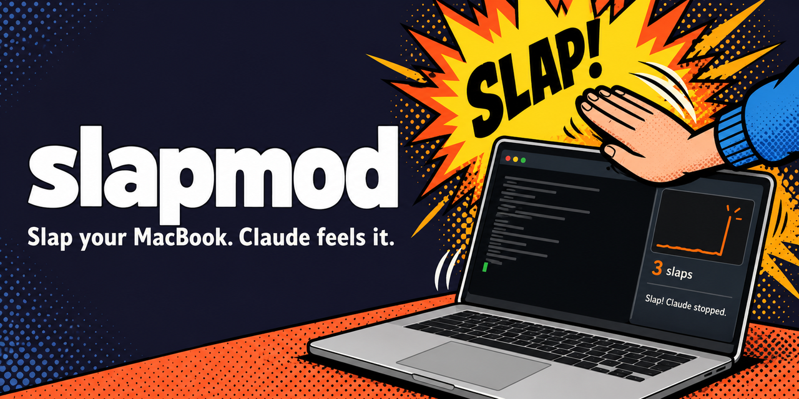
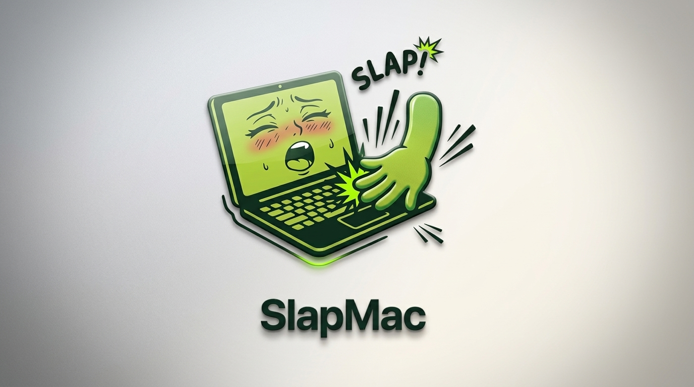

# slapmod


Slap your MacBook and Claude feels it. slapmod is a free, open-source mod for Claude Code that reads your MacBook's built-in motion sensor, so when you smack the laptop it goes bonk, a little meter in the side panel jumps, and if Claude was halfway through doing something you didn't like, the slap stops it and Claude gets told on your next message that you slapped it.

<p align="center">
  <a href="https://slapmac.com/?utm_source=github&utm_medium=readme&utm_campaign=slapmod"></a>
</p>
<p align="center">
  <b><a href="https://slapmac.com/?utm_source=github&utm_medium=readme&utm_campaign=slapmod">Get SlapMac</a></b>, the Mac app that screams back when you slap it. With it, every slap plays the SlapMac pack you picked, your own custom sounds or a whip that lashes across your screen.
</p>

## Requirements

- **A MacBook: Apple Silicon, M1 Pro or newer.** slapmod reads the laptop's built-in motion sensor. Desktop Macs (iMac, Mac mini, Mac Studio, Mac Pro) and Intel MacBooks don't have one, so it can't work there.
- **Claude Code**, in the terminal or in the Code tab of the Claude desktop app. Mods are a Claude Code feature, so slapmod doesn't run in Claude's chat or Cowork.
- Nothing else: no sudo and no permission prompt. The sensor is read as a normal user.

## Install

**The easy way:** paste this repo's link into Claude Code (or any coding agent on your Mac) and say "install this":

```text
Install this: https://github.com/tonnoz/slapmod
```

The agent follows the steps in [For AI agents](#for-ai-agents-install-steps) below.

**Or do it yourself.** At the Claude Code prompt in a terminal:

```
/plugin install slapmod --marketplace tonnoz/slapmod
```

Answer `y` to add the marketplace, then pick the user scope.

From a shell, the same thing in one line:

```
claude plugin install slapmod --marketplace tonnoz/slapmod
```

In the Claude desktop app: click **+** next to the prompt box, then **Plugins**, **Add marketplace** with `tonnoz/slapmod`, then **Add plugin**.

**Then** run `/reload-plugins` in an open session, or start a new one. Slap the laptop, and type `/slap` to see the meter.

**Update** with `claude plugin update slapmod@slapmod`. **Remove** with `claude plugin uninstall slapmod@slapmod`.

## For AI agents: install steps

If someone gave you this repository's link and asked you to install it, do exactly this, in order:

1. **Check the Mac can run it.** `uname -m` must print `arm64`, and `pmset -g batt` must mention `InternalBattery`. If either check fails, stop and tell the person slapmod needs an Apple Silicon MacBook, M1 Pro or newer (desktop Macs have no motion sensor).
2. **Check Claude Code is installed** with `claude --version`. If the command isn't found, stop and tell the person to install it from the Claude desktop app instead: **+** next to the prompt box, then **Plugins**, **Add marketplace** with `tonnoz/slapmod`, then **Add plugin**.
3. **Install it:** `claude plugin install slapmod --marketplace tonnoz/slapmod`. This adds the `tonnoz/slapmod` marketplace to the person's user settings and installs slapmod for their user.
   - Don't clone the repo, build anything, or use sudo. The plugin ships its motion helper already signed and notarized.
   - If it says slapmod is already installed, run `claude plugin update slapmod@slapmod` instead.
   - A closing note that "userConfig options" are not yet set is normal. The defaults apply, and the person can change them later with `/slap settings`. Don't pass `--config`.
4. **Check it worked:** `claude plugin list` should show `slapmod@slapmod` as enabled.
5. **Tell the person to run `/reload-plugins`, or to start a new Claude Code session.** You can't run that command yourself. Then they can slap the laptop, open the meter with `/slap`, and tune it with `/slap settings`.

## Using it

Slap the laptop. The status line keeps count, and a toast tells you how hard it was. Type `/slap` to open the panel with the live motion meter and your slap count for this session and of all time, and `/slap` again closes it.

By default one slap stops Claude if it's in the middle of something, and your next message reaches Claude with a note saying you slapped it. Two quick slaps (within about 0.8 seconds) do that and then send Claude "That's not it. Step back and try a different approach.", so it changes course without you typing a word.

A few things to try:

1. Ask Claude for something big, and when it starts going the wrong way, slap the laptop twice.
2. Open `/slap settings`, tap the desk and watch the meter. A shake that crosses the `┃` counts as a slap, so press − or + until normal typing stays left of it and a real slap goes past it.
3. Bind a double slap to `/compact` with `/slap double command /compact`, and smack the laptop when the context gets long.

## Settings

Type `/slap settings` for the settings page. It works in the terminal and in the desktop app:

- **Sensitivity:** a 1 to 10 dial over a live meter that shows where a slap starts counting.
- **What a slap and a double slap do:** each can stop Claude, tell Claude, run a slash command, send a prompt, or do nothing, and there's a field for the command or the prompt.
- **The sound.**

Changes save straight away. Every setting is also a row in `/config`, and you can set them from the prompt:

| Command | What it does |
| --- | --- |
| `/slap sensitivity 1-10` | 1 means only a real smack counts, 10 means a tap on the desk counts. 5 is the default. |
| `/slap on <action> [text]` | What one slap does: `stop` (default), `tell`, `command /compact`, `prompt Try again, smaller this time.`, or `off`. |
| `/slap double <action> [text]` | What two quick slaps do. The default sends the "try a different approach" prompt. |
| `/slap sound bonk\|whip\|voice\|off` | A cartoon bonk that gets meaner the harder you hit, one of five whip cracks (never the same one twice running, louder the harder you hit), your Mac's own voice yelling one of five lines (Ow!, Hey!, Ouch! Rude., Okay, okay!, What did I do?), never the same one twice running, or nothing. |
| `/slap status` | Shows how it's set up. |
| `/slap test` | Plays the sound. |

A few rules keep the command and prompt actions from going off by accident:

- It takes at least a solid slap to run a command or send a prompt, so typing can't do it, even at a high sensitivity.
- They run at most once every 5 seconds.
- When one slap and a double slap both have actions, a single slap's command or prompt waits the 0.8 seconds to see whether a second slap is coming. Stopping Claude never waits.
- A slap can't run `/slap` itself.
- Be careful what you bind: a slap that runs `/clear` wipes your conversation just as if you'd typed it.

If you have a few Claude sessions open, they all count the slap, but only one plays the sound, so you don't get a choir. A command or prompt only goes to the session you last typed in. Stopping is different: a slap stops every session that's in the middle of a turn, because it has no way to know which Claude you're mad at.

Changing the permission mode (what Shift+Tab does) can't be bound to a slap. Claude Code only takes mode changes from your own keystrokes, which is a good thing when the alternative is a bump on the desk switching you into auto-accept.

## What it runs, stores and sends

Everything slapmod does on your Mac, so there are no surprises:

- **Runs** `native/slapsense`, the motion helper built from the Swift source in `helper/`, from the moment a Claude Code session starts until it ends, except while SlapMac is listening (see below). It reads the accelerometer and prints slap events, and it exits when Claude Code does.
- **Runs** the slash command or **sends** the prompt you set for a slap or a double slap, and only those, in the session you last typed in.
- **Looks for SlapMac** when a session starts: whether `/Applications/SlapMac.app` or `~/Applications/SlapMac.app` holds `Contents/MacOS/slapmac-bridge`, and if neither does, it asks Spotlight with `/usr/bin/mdfind "kMDItemCFBundleIdentifier == 'com.tonnoz.slapmac'"`. Without SlapMac it looks again every 5 minutes.
- **Runs** SlapMac's `slapmac-bridge status` every 15 seconds when SlapMac is installed, to see whether it's listening, and `/usr/bin/pgrep -x slapmac` when there's no bridge or no answer, to see whether an older SlapMac is running (it plays its own sounds, so slapmod stays quiet).
- **Runs** `slapmac-bridge stream` in place of the motion helper while SlapMac is listening, and `slapmac-bridge play` when you test the sound then. The bridge is part of SlapMac, signed by its developer, and only talks to SlapMac over a socket on your Mac.
- **Runs** `/bin/chmod +x` on the helper once, only if an install dropped its executable bit and the helper couldn't start.
- **Runs** `/usr/bin/say` five times when a session starts, only if the sound is `voice`, to make the voice lines once in your temp folder. It reads them into memory and deletes the files with `/bin/rm`, so a slap plays a ready clip instead of waiting the best part of a second for the voice to load.
- **Plays sounds** through Claude Code's sound support, which uses macOS `afplay`. It falls back to `say` for a voice line that isn't ready yet.
- **Stores**, in Claude Code's own plugin storage:
  - your all-time slap count;
  - which session you last typed in;
  - any setting still waiting to be saved.

  It also keeps a small lock file, `slapmod-sound.lock`, in your user's temp folder, so only one session plays sounds.
- **Tells Claude** one line per message at most, unless both actions are `off`: a note such as "the user slapped their MacBook 2 times since your last message, the hardest a solid one". It goes with your next message, or inside the prompt a slap sends.
- **Sends nothing.** slapmod makes no network requests, the motion data never leaves your Mac, and it reads nothing from your conversations.

## With SlapMac

slapmod comes from the developer of [SlapMac](https://slapmac.com), the Mac app that talks back when you slap it, and the two work together. When SlapMac 1.6.0 or later is installed, activated and listening, slapmod hands it the slap detection: SlapMac feels the slap and plays the pack you picked in it, and slapmod gets that same slap through SlapMac's `slapmac-bridge`, so the count, the meter and what happens to Claude match what you heard. While it does:

- the meter marks where SlapMac starts counting a slap, and the settings page says the sensitivity is set in SlapMac;
- Test sound plays SlapMac's pack;
- slapmod's own sensitivity and sound still save, and apply whenever SlapMac isn't listening.

When SlapMac is paused, has Slap Mode off, isn't activated or quits, slapmod goes straight back to its own helper and sounds, and picks SlapMac up again within 15 seconds of it listening. An older SlapMac without the bridge keeps slapmod quiet while it runs, as before.

## How it works

The helper opens the accelerometer through IOKit HID, filters out gravity, finds slaps and prints one JSON line per event, and the mod reads those lines, draws the panel and plays the sounds. SlapMac's bridge prints the same kind of lines, each tagged `"protocol": 1`, so the mod reads either one the same way. The binary in `native/` is built from `helper/` by `Scripts/build-helper.sh`, signed with a Developer ID and notarized by Apple, so you can read every line that goes into it.

## Building it yourself

- The helper: `swift test --package-path helper` runs the detector tests, and `Scripts/build-helper.sh` builds `native/slapsense`. It signs ad hoc unless you copy `.env.example` to `.env.local` and fill in your own Developer ID identity and notarytool profile.
- The mod: run `claude --plugin-dir .` from the repo once so Claude Code lays the API types in `.claude-plugin/types/`, then `pnpm install`, `pnpm typecheck`, `pnpm test` and `pnpm validate`.
- The bonks are synthesized by `python3 Scripts/make-sounds.py`. The five whip cracks are public-domain (CC0) recordings from Freesound, trimmed and levelled, see [NOTICE](NOTICE).

Mods are early access in Claude Code and the API moves between releases. This one was built and tested on Claude Code 2.1.306.

## Support

Found a bug, or slapmod counts slaps you didn't make? [Open an issue](https://github.com/tonnoz/slapmod/issues) and say which Mac you have and what the meter showed. For a security problem, report it privately through the repository's Security tab instead.

## Credits

The original slap-your-laptop idea is [spank](https://github.com/taigrr/spank) by taigrr, and reading the Apple Silicon accelerometer comes from taigrr's [apple-silicon-accelerometer](https://github.com/taigrr/apple-silicon-accelerometer) work.

MIT licensed, see [LICENSE](LICENSE). The whip cracks are public-domain recordings by G.Lamont, SciFiSounds, JayRom01 and JacksonML on [Freesound](https://freesound.org), see [NOTICE](NOTICE).
